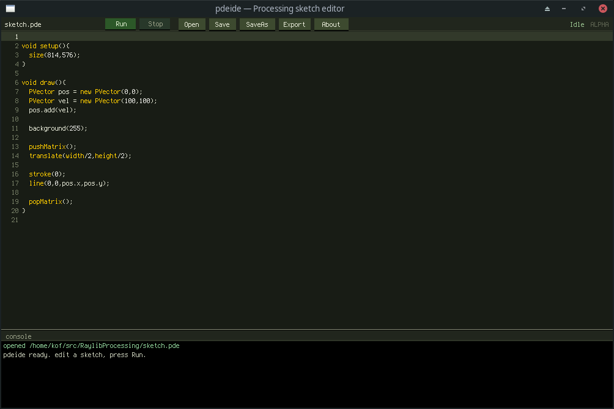

# Processing in Raylib

Transpile `.pde` Processing sketches to plain C and run them on raylib,
without Java. `pde2c` does the transpiling, `processing.h` is the
single-header runtime API, `libraries/` supplies drop-in C replacements for
the most common Processing libraries, and `pdeide` is a small editor wrapping
the chain.



> ALPHA quality: useful, honest, incomplete.

**Currently supported features:**
-   **Core drawing**: shapes, transforms, text, images
-   **Key APIs**: G1-G11 reference-audit stubs, `min()/max()` (3-arg + arrays), `delay()/cursor()/noCursor()`
-   **Data conversion/manipulation**: `binary()/unbinary()`, `trim()`, `byte()` (clamped 0-255), `boolean()`
-   **Style management**: `pushStyle()/popStyle()`
-   **Object model**: user classes with constructors/methods, `ArrayList`, class-typed globals
-   **Libraries**: ten `import`-compatible headers in [libraries/](#libraries), wired in automatically

**Limitations:**
-   No inheritance, generics, or external Java libraries.
-   `try/catch` not implemented.
-   Most `String` methods are not yet supported. Supported: `.charAt(i)`, `.indexOf()`, `.substring()`, `.toLowerCase()`, `.toUpperCase()`, `.replace()`, `.equals()`, `.length()`, `.trim()`, plus `+=` concatenation and `==`/`!=` operators.

## Quick start

```sh
./run                    # run the sketch in the current directory
./pdecc ~/my/sketch.pde  # build an optimized binary next to the source
./build/pdeide           # launch the editor
```

## Build

```sh
cmake -S . -B build            # submodules (raylib, freetype) bootstrapped automatically
cmake --build build -j
ctest --test-dir build         # headless unit tests (no window/GPU needed)
cmake --build build --target release   # -> build/pdeide-linux.tar.gz
```

## Libraries

`pde2c` drops the Java `import` lines and emits `#include`s for every header
in `libraries/` instead, so sketches using these libraries transpile, compile
and link with no extra flags. The transpiler also knows the library types, so
`new Capture(this, 640, 480)`, `minim.loadFile(...)` or `cam.read()` are
rewritten into the right C constructor/method call.

| Header | Processing import | Status |
| :----------------- | :-------------------------- | :--- |
| `libraries/io.h` | `processing.data` file I/O | **real** — `createReader`, `BufferedReader.readLine`, `createWriter`, `PrintWriter` |
| `libraries/serial.h` | `processing.serial.*` | **real** — POSIX `termios` ports, `Serial.list()` from `/dev` |
| `libraries/arduino.h` | `processing.serial.Arduino` | pin-state model over the serial layer (no Firmata wire protocol yet) |
| `libraries/net.h` | `processing.net.*` | **real** — non-blocking TCP `Client`/`Server` sockets |
| `libraries/osc.h` | `oscP5.*` | **real** — UDP socket, `OscP5`, `NetAddress`, `OscMessage` |
| `libraries/xml.h` | `processing.data.XML` | **real** — self-contained parser: elements, attributes, children, entity unescaping |
| `libraries/minim.h` | `ddf.minim.*` | **real** — raylib audio backend (`AudioPlayer`, `AudioSample`), FFT with `getBand()`/`specSize()`, `SineWave`, `FadeIn`/`FadeOut` |
| `libraries/video.h` | `processing.video.*` | API + state machine only — `Capture`/`Movie`, `Capture.list()` from `/dev/video*`; no frame decoding yet |
| `libraries/midi.h` | `themiddlespike.*` | API surface, no-ops |
| `libraries/geomerative.h` | `geomerative.*` | API surface, no-ops (`RShape`, `RFont`) |

Each header is self-contained and guarded, so it can be included directly from
your own C sources as well.

## Android (Termux)

Sketches can be built and run directly on an Android phone inside **Termux**:
the whole pipeline (pde2c → gcc → raylib) runs on-device, no Android NDK or
host cross-compiler needed. The window appears through **Termux:X11**.

**One-time setup** (in a Termux session):

```sh
# Termux:X11 is an Android app — install that APK from its GitHub releases first.
./android-setup.sh      # enables x11-repo, installs termux-x11-nightly, openbox, freetype, raylib
```

**Build + run a sketch** (open the Termux:X11 app, then in Termux):

```sh
./runAndroid.sh                # build+run the sketch in the current directory
./runAndroid.sh ~/my/sketch    # build+run a sketch elsewhere
```

`pdedeps` detects Termux (bionic libc / `$PREFIX` under `/data/data`) and links
against the on-device `raylib` + `freetype` from `pkg`, dropping the
Linux-only `-lrt` and using `$PREFIX` include/ lib paths — so `./run`,
`wildtest` and `corpus.sh` work identically on the phone.

## Tests & health checks

**Unit tests** verify the `pde2c` transpiler, the `processing.h` runtime and
the library headers.
-   `make test` runs four suites: 45 editor checks, 116 runtime checks,
    58 library data checks and 63 library media checks — 282 checks total.
-   `ctest --test-dir build` runs the editor and runtime suites (no window, no GPU, no audio needed).

**Real-world corpus tests** run a batch of Processing sketches through the transpiler:

```sh
./wildtest ~/src/2010                # transpile + gcc -fsyntax-only, per-sketch pass/fail
./wildtest ~/src/LearningProcessing  # book corpus (2015, Processing 3 era)
./corpus.sh ../2010                  # transpile + full link, summary to corpus-results.txt
```

**Current corpus status:**

| Corpus | Pass Rate |
| :------------------------------- | :--------: |
| 2010 sketch archive (`~/src/2010`) | 74/168 (44%) |
| shiffman/LearningProcessing      | 172/428 (40%) |

Failures typically stem from Processing API that is still missing
(`beginRaw`, `Capture.start()`, `Client.readStringUntil`, custom `Thread`
subclasses) or from classic Applet-era sketches that call `setup()`/`draw()`
by hand instead of letting the framework do it. The native library headers
above lifted both corpora substantially (previously 21/168 and 122/428).
See [TODO.md](TODO.md) for the roadmap.


Author: Kof, 2026 — community software, provided as-is.
